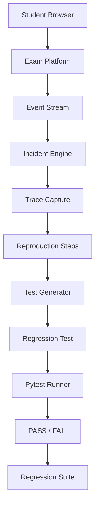
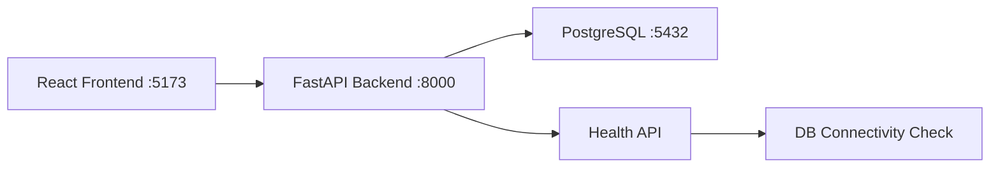

# Architecture

## System Overview
The Incident-to-Regression Pipeline is designed to transform production failures into automated test suites. 

## Full Pipeline Architecture (Target State)


## Phase 1 Architecture (Implemented)


## Backend Layer Architecture
```
API Layer (FastAPI routes)
    ↓
Service Layer (business logic)
    ↓
Domain Layer (entities, rules)
    ↓
Repository Layer (data access)
    ↓
Database Layer (PostgreSQL via SQLAlchemy)
```

## Directory Structure
- `/backend`: FastAPI service
- `/frontend`: React dashboard
- `/database`: DB utilities (Phase 1 placeholder)
- `/simulator`: Failure injection (Phase 2)
- `/incidents`: Incident management (Phase 2)
- `/regression_tests`: Generated tests (Phase 3)
- `/evaluation`: Experiment analysis (Phase 4)

## Why This Supports the Future Pipeline
This clean layered architecture separates data access (Repositories) from business logic (Services). As we introduce the Event Processor and Test Generator, they can operate as distinct domains without tangling with API routing or database session management. The health and observability foundation ensures we can track the complex state transitions required for tracing incidents.
