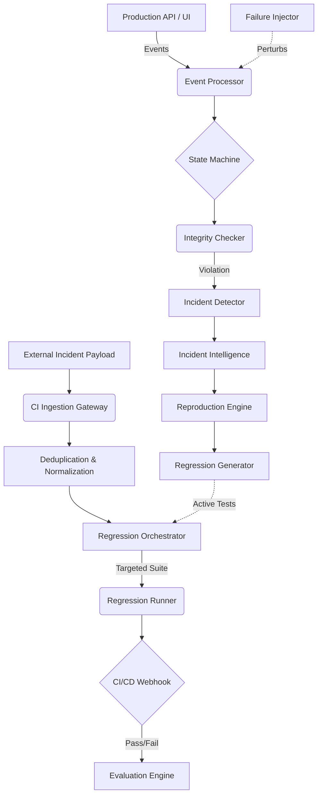

# Final Architecture

## System Overview
The Incident-to-Regression Pipeline is an event-driven architecture that bridges the gap between production telemetry/failures and automated CI/CD quality assurance.

## Core Flow

## Data Persistence (PostgreSQL / SQLite for Dev)
- **Application:** `exams`, `students`, `sessions`, `events`
- **Chaos/Failure:** `failure_experiments`, `injected_events`, `state_snapshots`
- **Incidents:** `incidents`, `incident_groups`, `incident_timeline`, `incident_root_causes`
- **Regression:** `regression_candidates`, `regression_tests`, `regression_runs`, `regression_proofs`
- **CI/Evaluation:** `external_incidents`, `regression_orchestrations`, `ci_regression_runs`, `evaluation_benchmarks`, `evaluation_experiments`

## Security & Scalability
- **Security:** JSON-DSL based regression execution (prevents arbitrary code execution). HMAC signature validation for external webhooks.
- **Scalability:** Event processing is decoupled from telemetry ingestion. Targeted test selection prevents CI bottlenecking as the regression suite grows.
