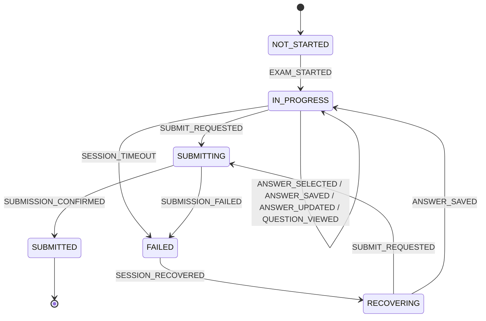
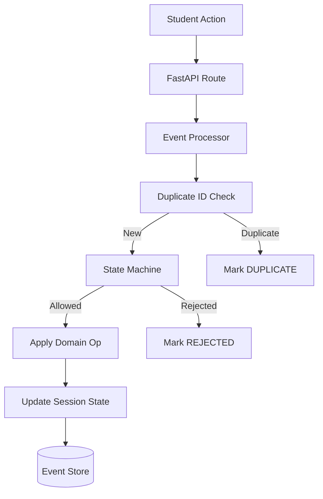

# Phase 2 — Online Examination Engine + Event-Driven Architecture

## Overview

Phase 2 builds the examination domain on top of the Phase 1 foundation. It introduces:
- A fully event-driven exam session state machine
- Persistent event store with sequence, correlation, and delay tracking
- Idempotent duplicate event and duplicate submission detection
- A complete student examination UI (Start → Answer → Submit)
- A QA/developer event trace and state inspector interface

## State Machine



**Invalid transitions are rejected** with a structured error response:
```json
{ "error": { "code": "INVALID_STATE_TRANSITION", "message": "Cannot save answers after submission", "request_id": "..." } }
```

## Event Architecture



## Event Structure

Every event includes `occurred_at` vs `received_at` — enabling delay detection for Phase 3 failure injection:

```json
{
  "event_id": "evt_abc123",
  "event_type": "ANSWER_SAVED",
  "session_id": "...",
  "sequence_number": 4,
  "correlation_id": "...",
  "causation_id": "...",
  "occurred_at": "2026-09-03T10:00:00Z",
  "received_at": "2026-09-03T10:00:01Z",
  "status": "PROCESSED",
  "payload": { "question_id": "...", "selected_option": "A" }
}
```

## Idempotency Design

### Event Idempotency
Events are checked by `event_id` at the database level (`UNIQUE` constraint). Any duplicate `event_id` returns `DUPLICATE` status and is recorded in the event store for audit purposes.

### Submission Idempotency
A `submission_key` is derived from `{session_id}_submit_{version}`. The `submissions` table has a `UNIQUE` constraint on this key. Any repeated `SUBMIT_REQUESTED` event results in `DUPLICATE` status and does **not** create a second `Submission` record.

### Answer Idempotency
Answers use `UPSERT` semantics: repeated answer saves for the same question update the existing `StudentAnswer` record rather than inserting a duplicate.

## Database Schema (Phase 2 Tables)

| Table | Purpose |
|-------|---------|
| `students` | Student identity |
| `exams` | Exam definitions |
| `questions` | Questions per exam |
| `answer_options` | Options per question |
| `exam_sessions` | One row per student attempt (includes `version` for optimistic concurrency) |
| `student_answers` | Saved answers per session/question (UNIQUE on session+question) |
| `submissions` | One per session (UNIQUE `submission_key`) |
| `events` | Full event store (UNIQUE `event_id`, indexed on `session_id`, `sequence_number`, `correlation_id`) |

## API Endpoints

| Method | Path | Description |
|--------|------|-------------|
| GET | `/api/v1/exams` | List exams |
| GET | `/api/v1/exams/{id}` | Get exam with questions |
| GET | `/api/v1/students` | List students |
| POST | `/api/v1/sessions` | Start exam session |
| GET | `/api/v1/sessions` | List all sessions (QA) |
| GET | `/api/v1/sessions/{id}` | Get session state |
| POST | `/api/v1/sessions/{id}/answers/{qid}` | Save answer |
| POST | `/api/v1/sessions/{id}/submit` | Submit exam |
| GET | `/api/v1/sessions/{id}/events` | Get full event trace |

## Known Limitations

- Sequence numbers are computed by counting existing events — not atomic. Will need a DB sequence in Phase 3.
- The seed script uses non-deterministic UUIDs. Phase 3 may benefit from fixed UUIDs for reproducible tests.
- WebSockets are not implemented yet (polling is used for trace refresh).

## Phase 3 Integration Points

- **Failure Injector**: The `EventProcessor` accepts a `BaseDomainEvent` — Phase 3 can supply `DelayedEvent`, `DuplicateEvent`, etc. without rewriting the processor.
- **Out-of-Order Detection**: The `sequence_number` field is stored for every event. The processor can be extended to detect gaps.
- **Incident Capture**: The event store contains enough fields (`correlation_id`, `causation_id`, `occurred_at`, `received_at`, `error_message`) to construct an `IncidentTrace`.
